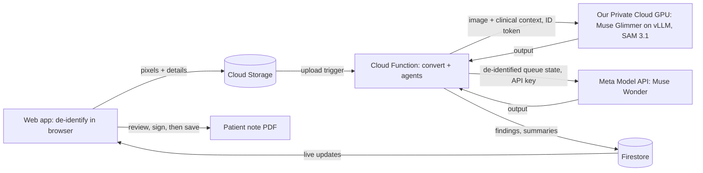

# HelioDX

HelioDX: Meta Muse Wonder coordinates a team of Muse Glimmer agents that
run the radiology workflow for clinics with no radiologist. Meta SAM 3.1
preps every scan. Glimmer and SAM run on our own GPU, so patient
images and reports stay in the project.

**Drafting assistance, never diagnosis.** Every AI finding starts as a
draft. A licensed clinician must accept, edit, or reject each one before
anything reaches the patient.

## Why

Tuberculosis is a top 5 killer disease in Nigeria. A clinic can take an X-ray but has no radiologist to read
it to detect the disease. The film waits days for a report, or the patient leaves without one. While
building a [mobile app](https://apps.apple.com/us/app/newcare-ai-for-clinicians/id6757157686) for Nigerian clinicians, this is the gap they describe most often. Nigeria (pop. - 242 million) has a doctor per 1,000 population, which is one of the lowest on the African continent compared to 2.6 per 1,000 people in the US ([Idowu & Okedere, Journal of Global Radiology · BMJ Open 2026](https://publishing.escholarship.umassmed.edu/jgr/article/id/576/)). HelioDX gives the clinician in the room a structured draft in under 5 minute, then steps aside so they can make the call and share it with the right people privately and compliantly.

## What it does

1. A clinician signs in to the web app with an account an admin created.
2. They upload a chest X-ray (DICOM, JPEG, or PNG), de-identified in the
   browser, or pick a sample, and add the indication.
3. The pipeline checks image quality, identifies the study type, and drafts
   findings with highlighted regions and measurements.
4. The clinician reviews each finding (accept, edit, or reject); the report
   redrafts from their decisions.
5. They sign the report. The patient note is then written from the signed
   text only, and code checks it: no instruction, test, urgency, or condition
   the signed report does not contain. They save it as a PDF for the patient
   (sending by WhatsApp to be supported later).

## Status

| Part | State |
|---|---|
| Web app (React + Vite) | Working: upload, review, sign, patient note PDF, agent console |
| Backend pipeline (Cloud Functions) | Working end to end on Muse Glimmer and SAM 3.1 |
| Muse Wonder coordination | Completed |
| Accuracy eval on public chest X-rays | Run 31 October 2026: 70 tasks on NIH ChestX-ray14, HelioDX vs MedGemma 27B on the same GPU. Results below and on the app's public `/evals` page ([`eval/README.md`](eval/README.md)) |

## Which model does what

| Model | Role | Runs on | Sees |
|---|---|---|---|
| Muse Glimmer (open weights) | Agents that check quality, set priority, draft findings, and write both summaries | Our Private Cloud GPU | Image measurements, clinical context, findings, reports |
| SAM 3.1 | Segments anatomy so every finding points at the region it rests on | Our Private Cloud GPU | The image |
| Muse Wonder 1.0 | Coordinator: plans each study and steps in when something goes wrong | Meta Model API | Queue state only: study IDs, stages, priorities, ages |
| Muse Voice Transcribe 1.0 | Turns the clinician's dictated edits on the Sign step into text | Meta Model API | The audio of one dictated edit, not kept |

Images and clinical text go only to our own GPU. The one exception is
dictation: a clinician who chooses to dictate an edit sends that clip to
Muse Voice Transcribe. The clip is passed straight through and never stored
or logged, and the app asks the clinician not to say the patient's name. The routing is enforced in
code (`functions/src/models/routes.ts`): a call to the hosted API that
carries an image or any field outside the de-identified queue allowlist is
refused before it is sent, and clinical calls never fall back to the hosted
API. Only the backend calls models, and the web app
never holds a model key.

## How it works



The app never calls a model directly. It uploads the image, and a
Storage-triggered Cloud Function prepares it and runs the agents. Muse Glimmer
and SAM 3.1 run on a private Cloud GPU service that only the
Function can call. Muse Wonder coordinates from the de-identified queue and
never sees an image or clinical text. The Function writes each step to
Firestore, which the app watches live. Every model response is checked
against a schema before it is saved. Patient details never go to a model,
analytics, crash reports, or logs. See
[`docs/phi-boundaries.md`](docs/phi-boundaries.md).

## Eval results

70 tasks on public NIH ChestX-ray14 films, graded by code, run on 31 October
2026 (commit `777914c`). Both systems ran on one NVIDIA RTX PRO 6000 each and
got the same SAM 3.1 masks and measurements, so only the language model
differs. Method, task files and limits: [`eval/README.md`](eval/README.md).
Every task and both outputs: the app's public `/evals` page.

| Family | Tasks | HelioDX (Glimmer 30B FP8) | MedGemma 27B (bf16) | Median time, H / M | Cost per task, H / M |
|---|---|---|---|---|---|
| Intake | 14 | 96.4% | 92.9% | 2.3 s / 3.6 s | $0.003 / $0.005 |
| Triage | 24 | 84.7% | 84.7% | 3.4 s / 6.5 s | $0.004 / $0.009 |
| Prep | 24 | 91.7% | 92.5% | 24.3 s / 46.8 s | $0.033 / $0.074 |
| Patient note | 8 | 90.0% | 60.0% | 2.4 s / 8.8 s | $0.004 / $0.011 |

Cost is GPU time at $4.50 per hour. On the held-out half of the films (the
lung cutoff was tuned on the other half), triage is 94.4% for HelioDX and
91.7% for MedGemma, and prep is 95.0% for both.

What it shows:

- HelioDX is about twice as fast and half the cost per task. Its clearest
  lead is the patient note (90% against 60%): rewriting a signed report
  without adding words or conditions.
- Triage and prep are level. Each system sent 2 of 4 pneumothorax films to
  the critical lane; HelioDX over-triaged fewer normal films (37.5% against
  50%).
- A weakness found: Glimmer called 3 of 4 clean PA films "AP", and the
  heart-size check runs only on PA films, so an enlarged heart can go
  unflagged. MedGemma read all 4 as PA.

## Hardware

Muse Glimmer and SAM 3.1 share one private Cloud Run GPU service in the EU.
Figures measured on the live service, 29 to 31 October 2026.

| | |
|---|---|
| GPU | 1× NVIDIA RTX PRO 6000 (96 GB), 24 vCPU, 80 GiB memory; at most one instance |
| Muse Glimmer | 30B dense, FP8 (per tensor), served by vLLM 0.32.0 (`vllm/vllm-openai:v0.32.0`) |
| SAM 3.1 | `facebookresearch/sam3@f1647e8`, checkpoint `sam3.1_multiplex.pt`, on the same GPU |
| Cold start | 5.0 to 5.8 min from a new instance to both models loaded (SAM is ready in about 30 s; the rest is Glimmer) |
| Warm, per call (median) | Quality check 2.4 s · study type 1.9 s · findings 21.4 s · report 11.5 s · patient note 2.4 s · one SAM segmentation 1.2 s |
| Warm, upload to draft | Median 29 s (23 to 86 s over 9 studies) |
| Scaling | Scales to zero when idle. One instance is kept warm for judging week (4 to 9 November) with `gpu/warm.sh on`, and turned off after |

## Run it yourself

You need Node 22 and Java 21 or newer for the Firebase emulators. No keys
are committed to this repo, so you bring your own Firebase project. You can
host your own GPU on premises or cloud provider such as [modal](https://modal.com/)

### 1. Set up a Firebase project

1. Create a Firebase project. The free plan is enough for the emulators;
   deploying needs the Blaze plan.
2. Register a Web app.
3. Copy `.env.example` to `.env.development` and fill in the Web app config.
   It is gitignored.

### 2. Run locally on the emulators, with mock AI

The pipeline returns fixtures instead of calling a model, so this costs
nothing and needs no model key. Set `EXPO_PUBLIC_USE_EMULATORS=1` in
`.env.development` first.

```sh
npm install && (cd functions && npm install && npm run build)
MODEL_MOCK=1 npx firebase emulators:start --project <your-project-id>
cd functions && GCLOUD_PROJECT=<your-project-id> SEED_PASSWORD=<choose-one> npm run seed
cd .. && npm --prefix web install && npm --prefix web run dev
```

The seed creates a demo organization and prints the admin's sign-in email.
Add `-- --with-radiologists` for three simulated radiologists (fast, slow
and silent) that sign in with the same password. You can manually upload
additional images from public repositories such as [Radiopaedia](https://radiopaedia.org/articles/normal-chest-imaging-examples?lang=us).

### 3. Deploy to your project

Enable Email/Password sign-in, Firestore and Storage. Keep your Meta Model API
key in Secret Manager, never in the repo or the app:
`npx firebase functions:secrets:set META_API_KEY`. Then:

```sh
npx firebase use --add
npx firebase deploy --only firestore:rules,firestore:indexes,storage,functions
cd functions && SEED_TARGET=project npm run seed -- --org my-clinic --domain myclinic.org --email you@myclinic.org
```

Grant the Functions runtime service account the Service Account Token Creator
role on itself, so it can sign share links.

### 4. The web app, the public demo and the agent console

The web client in `web/` (React + Vite, design in `design/`) is the
clinician's workspace in a browser: a welcome page, the worklist, one page
per study (analyze → review → sign → patient note → share → done) and the
agent console, which shows every model and tool call behind each case.
There is no public sign-up: judges sign in with a demo account an admin
creates. Demo accounts use synthetic patients and curated chest X-rays, see
only the cases they created, and keep them until the account is removed.

```sh
python3 data/fetch_demo_samples.py                         # ~10 NIH ChestX-ray14 images → data/out (not committed)
cd functions && SEED_TARGET=project npx tsx scripts/upload-samples.ts && cd ..
npm run build:web                                          # web/ → dist/
npx firebase deploy --only hosting,functions,firestore:rules,storage
cd functions && SEED_TARGET=project npm run demo-user -- add --email judge@example.org --seed
```

`demo-user add` prints a one-time password-setup link; set the password and
hand the sign-in to the judges privately (never in the repo). Give each judge
their own account: the sample studies are shared across the demo workspace,
so a sample one judge signs stays signed for everyone until someone presses
"Reset sample" (or you run `demo-user seed-samples --reset`). `--seed` (or
`demo-user reset`) starts the guided worklist: two cases ready to review and
one already signed and shared, all through the real pipeline. `demo-user
remove --email …` deletes the account and its cases.

Locally, run the emulators, upload the samples without `SEED_TARGET`, put
`EXPO_PUBLIC_USE_EMULATORS=1` in `.env.development.local` and start the web
app with `npm --prefix web run dev`.

### Tests

```sh
npm test && npm run typecheck                      # shared types/ and utils/
cd web && npm test && npm run typecheck            # web
cd functions && npm test                           # functions
cd functions && npm run test:rules                 # security rules, inside the emulators
```

## Security

- No API keys, service-account keys or passwords are committed. The Meta
  Model API key lives only on the server, in Secret Manager. `.env.*` files
  are gitignored; the template is `.env.example`.
- Firestore and Storage rules scope every study to the clinician's
  organization; an uploaded study's files are readable by its owner only.
  The rules have their own test suite.
- Outbound hosts: our own Cloud GPU service, the Meta Model API (Muse
  Wonder, de-identified queue state only), and, in the web app's upload
  panel, the tesseract.js engine and English model, fetched once from its
  default CDN for the burned-in text check. Only the OCR code and model are
  downloaded; image pixels never leave the browser for it.
- Uploads are de-identified in the browser: only the pixels go up, as a PNG.
  DICOM tags, photo metadata and the original file name stay on the machine,
  and ages over 89 are stored as "90+".
- Found a security issue? Please open a private security advisory on GitHub
  rather than a public issue.

## Limitations

- HelioDX is a beta project, not a medical device. It is not cleared for
  clinical use.
- Highlighted regions are approximate. Clinicians review the image, not the
  box.
- Compressed DICOM is not supported. Export as uncompressed DICOM, JPEG or PNG.
- A study whose model call fails transiently can get up to six attempts: three
  from the retry policy, then one coordinator requeue that starts three more,
  before it is escalated to a clinician.
- The coordinator's reading SLA (critical 5 min, urgent 30) pauses while a
  clinician has the case in review.
- Radiologist reads are simulated. A read is required before signing when the
  case is critical, an accepted finding has weak evidence, the clinician asks
  for one, or the case is flagged for a human. Three simulated readers take
  it: fast (about 2 min), slow (about 6 min) and silent (reminded, then
  reassigned to the fast reader). While a read is open, its timers replace
  the SLA. There is no radiologist screen.
- Study images in Storage can be read only by the clinician who owns the
  study. A real radiologist account could not load the film until Storage
  grants read access to the assigned reader.
- Dictation is limited to 60 seconds a clip, on the Sign step only. If the
  hosted transcriber is unavailable, the clinician types the edit instead.
- See [`docs/known-risks.md`](docs/known-risks.md) for the full list.

## Repo layout

| Path | What's there |
|---|---|
| `web/` | The web app (React + Vite): worklist, study workspace, agent console, public `/evals` page |
| `eval/` | The evaluation task library and how to run it |
| `design/` | Design spec, tokens and mockups for the web app |
| `functions/` | Cloud Functions: pipeline, callables, admin scripts, tests |
| `gpu/` | Private model service: Muse Glimmer on vLLM and SAM 3.1 on Cloud Run GPU, with deploy scripts |
| `types/`, `utils/` | Data types and pure helpers shared by web and functions, with tests |
| `firestore.rules`, `storage.rules` | Security rules |
| `docs/` | Data boundaries, known risks |

## License

HelioDX is free software under the
[GNU Affero General Public License v3.0 or later](LICENSE). You may use,
change and share it. If you run a modified version as a network service, you
must offer its users the source code of your version.

Copyright (C) 2026 the HelioDX authors.

### Data

The demo samples are chest X-rays from the NIH Clinical Center ChestX-ray14
dataset, fetched by `data/fetch_demo_samples.py` and never committed here.
Cite: Wang X, Peng Y, Lu L, Lu Z, Bagheri M, Summers RM. *ChestX-ray8:
Hospital-scale Chest X-ray Database and Benchmarks on Weakly-Supervised
Classification and Localization of Common Thorax Diseases.* IEEE CVPR 2017.
Patients in the demo are synthetic; no real patient details are shown.

### Name and brand

The license covers the code only. It grants no rights to the HelioDX name,
the helio. logo or other brand assets, including the images in
`design/assets/`. Forks and modified versions must use a different name and
logo, and must not suggest they are made or endorsed by HelioDX. Saying
truthfully that your project is based on HelioDX is fine.
