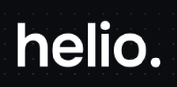

# HelioDX components

One reference implementation per component, lifted from the mockups. Build each once as a shared component, then compose screens from them. Values reference `tokens.css`; the literal hex is given beside each so the mockup CSS and the token line up.

Conventions: real elements (`<button>`, `<a href>`, `<input>` + `<label>`); min hit target 44 px (36 px only on the dark viewer toolbar and console-panel header); inline SVG icons, 16 px, `fill="none" stroke="currentColor" stroke-width="1.75" stroke-linecap="round" stroke-linejoin="round"`, `aria-hidden="true"`.

## App header

```html
<header class="hx-header">           <!-- min-height 56px; white; border-bottom 1px --hx-line; padding 8px 20px; flex; gap 14px; wrap -->
  <a href="/worklist" aria-label="HelioDX home"></a>
  <span class="hx-chip hx-chip--warn">Research Beta · Not ready for clinical use</span>
  <div style="flex:1 1 auto"></div>
  <nav aria-label="Breadcrumb">…Worklist › <strong>Sample Patient 1</strong></nav>   <!-- 13px, muted; current item ink 600 -->
  <div class="hx-avatar" title="Dr. Demo Clinician">DC</div>                          <!-- 34px circle; bg ink #15181C; white text; 700 13px -->
</header>
```

## Buttons

```css
.hx-btn{display:inline-flex;align-items:center;justify-content:center;gap:8px;min-height:44px;padding:0 18px;border-radius:8px;font:inherit;font-weight:600;font-size:14px;border:1px solid transparent;white-space:nowrap;color:#15181C}
.hx-btn--primary{background:#15181C;color:#fff}            .hx-btn--primary:hover{background:#000}
.hx-btn--secondary{background:#fff;border-color:#C9CFD6}   .hx-btn--secondary:hover{background:#F4F6F8}
.hx-btn--secondary.is-on{background:#15181C;color:#fff;border-color:#15181C}   /* pressed toggle, aria-pressed="true" */
.hx-btn--ghost{background:transparent;color:#15181C;padding:0 10px}
.hx-btn--dark{background:transparent;color:#C8D0D8;border-color:#2A323B;min-height:36px;padding:0 12px;font-size:13px}  /* viewer toolbar */
.hx-btn--dark.is-on{background:#1A2027;color:#fff;border-color:#fff}
.hx-btn[disabled]{opacity:.55;cursor:not-allowed}            /* always pair with an aria-describedby hint that says what is missing */
```

Icon button (per-finding controls, close):

```css
.hx-ib{width:44px;height:44px;padding:0;border-radius:8px;border:1px solid #C9CFD6;background:#fff;color:#3D444D;display:inline-flex;align-items:center;justify-content:center}
.hx-ib:hover{background:#F4F6F8;color:#15181C}
.hx-ib.is-on{background:#137A3A;border-color:#137A3A;color:#fff}      /* accepted (green = success) */
.hx-ib--danger:hover{color:#B42318;border-color:#B42318}             /* reject (red = failure) */
```

Landing pills: `min-height:48px; padding:0 22px; border-radius:999px; font-size:15px`; light `#F2F5F3` on ink, dark `#14181F` with border `#2A313B`.

## Chips and tags

```css
.hx-chip{display:inline-flex;align-items:center;gap:6px;height:24px;padding:0 9px;border-radius:999px;font-size:12px;font-weight:600;line-height:1;white-space:nowrap}
.hx-chip--ok{background:#E6F4EA;color:#137A3A}       /* success: Draft ready · Normal · Ready · Live · Checked against the signed report */
.hx-chip--warn{background:#FDECEA;color:#B42318}     /* failure/attention: needs attention · unsupported sentence · errors */
.hx-chip--env{background:#fff;color:#15181C;border:1px solid #15181C}   /* the environment chip in the header: outline, neither success nor failure */
.hx-chip--neutral{background:#EDF0F3;color:#3D444D}  /* Analyzing · Editing · Edited by you */
.hx-chip--ink{background:#15181C;color:#fff}         /* Signed · Shared */
.hx-tag{display:inline-flex;align-items:center;height:20px;padding:0 7px;border-radius:5px;font-size:11.5px;font-weight:600;background:#EDF0F3;color:#3D444D}  /* trace agent */
.hx-tag--model{background:#15181C;color:#fff}     /* Glimmer · SAM 3.1 */
```

Number chip (finding number, in lists and the report): 24 px circle, bg `#15181C`, white 12 px 700.

Uppercase label: `font-size:11.5px;font-weight:600;letter-spacing:.06em;text-transform:uppercase;color:#5F6873`.

Keyboard key: `.hx-kbd{min-width:20px;padding:1px 5px;border:1px solid #C9CFD6;border-bottom-width:2px;border-radius:4px;font-family:mono;font-size:11px;color:#3D444D;background:#fff}`.

## Card

`background:#fff;border:1px solid #E1E5EA;border-radius:12px`. Table cards add `overflow:hidden` and a header row on `#FAFBFC`.

## Step rail

```html
<nav aria-label="Progress" class="hx-rail">   <!-- flex; gap 10px; wrap; inside a white strip, padding 12px 28px, border-bottom -->
  <div class="hx-step is-done"><span class="hx-dot">✓(svg)</span>Analyze</div><span class="hx-rule"></span>
  <div class="hx-step is-cur"><span class="hx-dot">2</span>Review</div><span class="hx-rule"></span>
  <div class="hx-step"><span class="hx-dot">3</span>Sign</div>…
</nav>
```
```css
.hx-step{display:flex;align-items:center;gap:8px;font-size:13px;font-weight:500;color:#5F6873;white-space:nowrap}
.hx-step.is-cur{color:#15181C;font-weight:600} .hx-step.is-done{color:#137A3A}
.hx-dot{width:22px;height:22px;border-radius:50%;display:inline-flex;align-items:center;justify-content:center;font-size:11.5px;font-weight:600;border:1.5px solid #C9CFD6;color:#5F6873;background:#fff}
.hx-step.is-cur .hx-dot{background:#15181C;border-color:#15181C;color:#fff}
.hx-step.is-done .hx-dot{background:#137A3A;border-color:#137A3A;color:#fff}
.hx-rule{width:22px;height:1px;background:#C9CFD6}
```
Done steps are `<a>` back to that step; current and future are `<div>`.

## Viewer (image pane)

```html
<section class="hx-viewer" aria-label="Image viewer">    <!-- flex 0 1 620px; bg #0C1014; color #C8D0D8; column -->
  <div class="hx-viewer__bar">…patient · meta · spacer · .hx-btn--dark toggles…</div>   <!-- min-height 48px; border-bottom 1px #1C2229 -->
  <div class="hx-viewer__stage">                                                         <!-- flex 1; center; padding 20px -->
    <div class="hx-film" style="aspect-ratio:1346/1140">                                <!-- position relative; width 100%; max-width 580px; overflow hidden; radius 4px -->
      
      <!-- overlays: .hx-spot, .hx-line, .hx-ltag, .hx-marker … positioned in % -->
    </div>
  </div>
  <div class="hx-viewer__status">…</div>                                                 <!-- min-height 40px; border-top; 12.5px #8B96A3 -->
</section>
```

Overlays:

```css
.hx-marker{position:absolute;width:28px;height:28px;margin:-14px 0 0 -14px;border-radius:50%;background:#137A3A;color:#fff;border:2px solid #fff;box-shadow:0 1px 5px rgba(0,0,0,.6);display:flex;align-items:center;justify-content:center;font-size:12.5px;font-weight:700;padding:0}
.hx-marker.is-focus{width:34px;height:34px;margin:-17px 0 0 -17px;background:#fff;color:#137A3A;border-color:#3DDC84;box-shadow:0 0 0 4px rgba(61,220,132,.35),0 1px 6px rgba(0,0,0,.6);font-size:14px}
.hx-spot{position:absolute;border:1.5px dashed #3DDC84;border-radius:50%;box-shadow:0 0 0 2000px rgba(12,16,20,.35)}   /* region spotlight; left/top/width/height in % */
.hx-line{position:absolute;height:0;border-top:1.5px solid #3DDC84;box-shadow:0 0 6px rgba(61,220,132,.8)}
.hx-line::before,.hx-line::after{content:"";position:absolute;top:-5px;width:0;height:10px;border-left:1.5px solid #3DDC84} .hx-line::before{left:0} .hx-line::after{right:0}
.hx-ltag{position:absolute;transform:translate(-50%,-100%);background:rgba(12,16,20,.85);color:#DFF7E8;font-size:11px;padding:2px 6px;border-radius:4px;font-family:mono;border:1px solid rgba(61,220,132,.5)}
.hx-scan{position:absolute;left:0;right:0;height:2px;background:linear-gradient(90deg,rgba(61,220,132,0),#3DDC84 25%,#3DDC84 75%,rgba(61,220,132,0));box-shadow:0 0 14px rgba(61,220,132,.9);animation:scan 3.4s ease-in-out infinite alternate}  /* analyzing only */
```
Markers are `<button>`s with `aria-label="Finding 3, lung densities"`; clicking focuses the matching row.

## Finding row (Review)

```html
<div class="hx-finding is-focus">                     <!-- grid: 24px minmax(0,1fr) 112px auto; gap 14px; padding 12px 14px; white; border 1px #E1E5EA; radius 12px -->
  <span class="hx-num">3</span>
  <div><strong>Lung densities are symmetric</strong><span class="hx-evidence">Left/right mean brightness ratio <code>1.09</code> · limit <code>1.25</code></span></div>
  <div class="hx-conf"><span>High · <code>90%</code></span><div class="hx-meter" aria-hidden="true"><span class="f"></span><span class="f"></span><span></span></div></div>
  <div class="hx-finding__actions"> .hx-ib accept · .hx-ib edit · .hx-ib.hx-ib--danger reject </div>
</div>
```
```css
.hx-finding.is-focus{border-color:#15181C;box-shadow:0 0 0 3px rgba(21,24,28,.14)}
.hx-finding.is-rejected{opacity:.6} .hx-finding.is-rejected strong{text-decoration:line-through}
.hx-evidence{font-size:13px;color:#5F6873} .hx-evidence code{font-family:mono;font-variant-numeric:tabular-nums}
.hx-meter{display:flex;gap:3px} .hx-meter>span{width:14px;height:6px;border-radius:2px;background:#E1E5EA} .hx-meter>span.f{background:#15181C}
```
Editing state swaps the grid to `24px minmax(0,1fr)` and renders: title + neutral chip "Editing", `<label>Wording in the report<input type="text"></label>`, "Save and accept" (primary, 40 px) · "Cancel" (ghost) · muted measured-value line.

Progress bar: `.hx-bar{height:6px;border-radius:3px;background:#E1E5EA;overflow:hidden} .hx-bar>span{display:block;height:100%;background:#15181C}` with `role="progressbar"`.

## Analysis step list

Row: 22 px tick circle (done: bg `#E6F4EA` + green `#137A3A` check svg; running: bg `#EDF0F3` + 10 px pulsing green dot; todo: 1.5 px `#C9CFD6` ring) · label · muted detail. Skeleton card: dashed border, 24 px grey circle, two shimmer bars (`linear-gradient(90deg,#E8EBEF 25%,#F4F6F8 50%,#E8EBEF 75%)`, size 200 %, `animation: shimmer 1.4s linear infinite`), `aria-hidden="true"`.

## Report block (Sign)

Card padding 22 px 24 px; sections with uppercase label; FINDINGS as `<ol>` of `<li class="hx-fl">` (`display:flex;gap:10px;line-height:1.5`) with a 22 px number chip; IMPRESSION as a numbered `<ol>` with 20 px padding-left; info line at the bottom with a 14 px info icon.

## Signed strip (Share)

`background:#E6F4EA;color:#137A3A;border-bottom:1px solid #BFE3CB;padding:8px 28px;font-size:13px;display:flex;gap:12px` with `role="status"`: lock icon · "**Report signed** by … · today 14:33 · `sha256 a6bd4ea5…` · locked" · spacer · "View signed report" link.

## Option card (Share channels)

```html
<label class="hx-opt is-on"><input type="radio" name="channel" checked><span class="hx-ico">(svg)</span><span><strong>WhatsApp</strong><span class="mono muted">+1 555 010 01</span></span></label>
```
```css
.hx-opt{display:grid;grid-template-columns:22px 36px minmax(0,1fr);gap:14px;align-items:center;padding:14px 16px;background:#fff;border:1px solid #E1E5EA;border-radius:12px;cursor:pointer}
.hx-opt.is-on{border-color:#15181C;box-shadow:0 0 0 3px rgba(21,24,28,.12)}
.hx-ico{width:36px;height:36px;border-radius:8px;background:#EDF0F3;color:#3D444D;display:inline-flex;align-items:center;justify-content:center} .hx-opt.is-on .hx-ico{background:#15181C;color:#fff}
```
Inputs: `font:inherit;font-size:14px;border:1px solid #C9CFD6;border-radius:8px;padding:10px 12px;min-height:44px`; focus `outline:2px solid #15181C;outline-offset:1px`. Checkbox/radio 18 px with `accent-color:#15181C`.

## Patient note card

460 px max, white, border `#E1E5EA`, radius 14 px, padding 26 px 28 px, shadow `0 8px 24px rgba(21,24,28,.06)`; header row (clinician · clinic / date), h2 20 px 700, body 15 px / 1.55, "What happens next" block, divider, two muted 12.5 px footer lines.

## Timeline (Done audit trail, console panel)

Grid `56px 28px minmax(0,1fr)` (Done: with time column) or `18px minmax(0,1fr)` (console). Rail: 12 px (Done) / 10 px (console) circle with 2 px green `#137A3A` ring, white fill; clinician steps filled ink `#15181C`; 2 px `#E1E5EA` line below each except the last; current/last step green-filled. Body: bold title, muted 13 px detail; console rows add tags and a right-aligned mono "2.7 s · 1 726 tok".

## Stat tile

Panel: `padding:10px 12px;background:#F4F6F8;border-radius:8px` with mono 15 px 600 value over 11.5 px muted label. Page: white card, border, radius 10 px, mono 18 px value, 12 px label. Grid `repeat(auto-fit, minmax(min(96px|150px, 100%), 1fr))`.

## Trace row (console page)

Grid `150px 84px minmax(160px,1fr) 80px 90px minmax(260px,2fr) 44px`, gap 14 px, padding 10 px 16 px, top border; expanded row bg `#F4F6F8`; the details block sits under it with `padding:14px 16px 18px 46px`, tabs (36 px, bottom-border current), three-column detail grid, action buttons 36 px.

## Toast

Bottom-centre, 360–480 px, ink background `#15181C`, white 14 px text, radius 10 px, padding 12 px 16 px, optional action link in green-bright `#3DDC84`, close button 36 px, `role="status"`, auto-dismiss 5 s, one at a time.

## Pulse dot and "Live" chip

`.hx-pulse{width:8–10px;height:8–10px;border-radius:50%;background:#16A34A;animation:pulse 1.2s ease-in-out infinite}`. Respect `prefers-reduced-motion` (no animation; the dot stays solid).

## Landing components

Dark card: `background:#10141A;border:1px solid #1E242C;border-radius:14px`. Step card: mono `01` accent, 17 px white h3, 14 px body `#B5BDB7`, 12.5 px muted hint. Finding chip on the film: `.lx-fchip{position:absolute;display:inline-flex;gap:8px;padding:8px 12px;border-radius:999px;background:rgba(10,12,16,.88);border:1px solid rgba(127,238,100,.4);color:#E6EBE7;font-size:12.5px;box-shadow:0 8px 24px rgba(0,0,0,.5)}` with an 8 px accent dot. Landing marker: 26 px, bg `#7FEE64`, ink text, 2 px `#0A0C10` border, 2 px accent-ring halo. Meta badge: white, radius 12 px, padding 12 px 22 px, logo 40 px high.

## Upload panel

Same shell as the console panel, 520 px (`--hx-upload-w`), white, left border; header h2 + optional neutral chip "N files" + close; footer with the status sentence left and Cancel / primary right.

Drop zone:

```css
.hx-drop{border:2px dashed #C9CFD6;border-radius:12px;padding:36px 24px;display:flex;flex-direction:column;align-items:center;gap:12px;text-align:center;background:#FAFBFC}
.hx-drop.is-over{border-color:#15181C;background:#F4F6F8}          /* dragover */
.hx-filebtn{position:relative;overflow:hidden} .hx-filebtn input{position:absolute;inset:0;opacity:0;cursor:pointer;width:100%;height:100%}   /* a .hx-btn--secondary <label> wrapping the real <input type="file"> */
.hx-addmore{border:1.5px dashed #C9CFD6;border-radius:10px;min-height:44px;display:flex;align-items:center;justify-content:center;gap:8px;color:#15181C;font-weight:600;font-size:13px;background:#FAFBFC;position:relative;overflow:hidden}
```

Queue card:

```html
<div class="hx-q is-sel" role="button" tabindex="0" aria-pressed="true">   <!-- grid 56px minmax(0,1fr) 36px; gap 12px; padding 12px; white; border 1px #E1E5EA; radius 12px -->
                                     <!-- 56px, object-fit cover, bg #0C1014; opacity .55 while uploading -->
  <div> name + "2.1 MB · JPEG" · status line (chip + sentence) · optional progress bar · optional ghost actions </div>
  <button class="hx-ib hx-ib--plain" aria-label="Remove …">×</button>
</div>
```
```css
.hx-q.is-sel{border-color:#15181C;box-shadow:0 0 0 3px rgba(21,24,28,.12)}
.hx-q.is-attention{border-color:#F3B9B3}                                     /* red line; chip .hx-chip--warn */
.hx-qbar{height:6px;border-radius:3px;background:#E1E5EA;overflow:hidden} .hx-qbar>span{display:block;height:100%;background:#15181C}
```

Details card: light ground `#FAFBFC`, uppercase label "Details · <file>", inputs 44 px, a 3-column `auto-fit` grid for Age / Sex / View, textarea min-height 72 px, required checkbox row.

De-identification preview:

```css
.hx-flag{position:absolute;border:2px dashed #FF6B6B;border-radius:4px;box-shadow:0 0 0 2000px rgba(12,16,20,.45)}   /* flagged region; left/top/width/height in % */
.hx-ftag{position:absolute;transform:translateY(-100%);background:#B42318;color:#fff;font-size:11px;font-weight:600;padding:3px 7px;border-radius:4px}
```
Red banner: `background:#FDECEA;border:1px solid #F3B9B3;border-radius:12px;padding:14px 16px` with a 28 px red disc icon, bold red first sentence, grey explanation, ghost actions. Tag lists: `.hx-kv` rows (13 px, `#3D444D`) with a 16 px green check disc (`#E6F4EA` / `#137A3A`) for removed tags and a grey disc for kept tags.

## Source tag, sample thumbnail, worklist section

Source is shown by shape and words, never by colour (SPEC.md §4.11).

```html
<span class="hx-src hx-src--up"><svg …upload icon 10px…></svg>Uploaded</span>
<span class="hx-src hx-src--sample">Sample</span>
```
```css
.hx-src{display:inline-flex;align-items:center;gap:5px;height:20px;padding:0 7px;border-radius:5px;font-size:10.5px;font-weight:700;letter-spacing:.06em;text-transform:uppercase;line-height:1;white-space:nowrap}
.hx-src--up{background:#15181C;color:#fff}
.hx-src--sample{background:#fff;color:#5F6873;border:1px dashed #9AA0A6}
.hx-viewer .hx-src--sample{background:transparent;color:#C8D0D8;border-color:#8B96A3}   /* on the dark viewer */
.hx-viewer .hx-src--up{background:#fff;color:#15181C}
```

Sample thumbnail (decorative frame, `aria-hidden` on the wrapper is fine since the image is `alt=""`):

```css
.hx-thumb--sample{width:64px;height:64px;border-radius:6px;padding:3px;border:1.5px dashed #9AA0A6;background:#fff}
.hx-thumb--sample img{width:100%;height:100%;border-radius:3px;object-fit:cover;display:block;background:#0C1014;opacity:.85}
```

Worklist section header:

```html
<section aria-label="Your uploads">
  <div class="hx-sech">            <!-- flex; gap 12px; wrap; padding 0 4px -->
    <h2>Your uploads</h2><span class="hx-count">1</span>
    <span class="muted">De-identified in your browser · visible to you only · you can delete them</span>
    <div style="flex:1 1 auto"></div>
    <a class="hx-btn hx-btn--ghost hx-btn--sm" href="…">Upload another</a>
  </div>
  … table card …
</section>
```
Source filter: segmented control `.hx-seg` (36 px, 13 px, bordered pill group; current segment black with white text) inside `<nav aria-label="Filter by source">`.

Row overflow menu: 36 px icon button (three dots), `aria-haspopup="menu"`; items per source — uploads: Delete study (inline confirm row, never a modal), Download de-identified file, Open in console; samples: Reset sample, Open in console.
